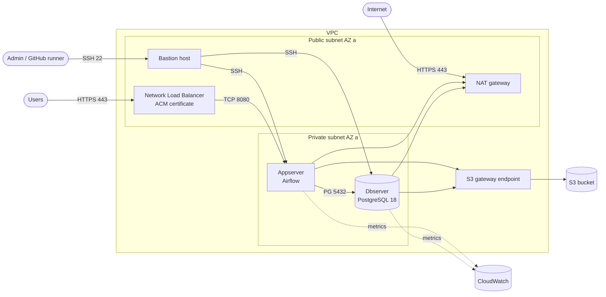

# AWS Infrastructure as Code Pipeline

## Overview
This  DevOps project, focused on Infrastructure as Code (IaC), GitOps and CI/CD. It automates the provisioning, configuration, and management of AWS infrastructure using Terraform, Ansible, Git, and GitHub Actions.

The platform is a **self-managed PostgreSQL database on EC2**, running in a private subnet and reachable only through a bastion host, with an Airflow instance as its first client. Everything from the network to the database roles is created from code and deployed through GitHub Actions.

## Table of Contents

- [Overview](#overview)
- [Highlights](#highlights)
- [Architecture](#architecture)
- [Infrastructure Provisioning](#infrastructure-provisioning)
- [Configuration Management](#configuration-management)
- [CI/CD](#cicd)
- [Prerequisites](#prerequisites)
- [Start](#start)
- [License](#license)

## Highlights

### Self-managed PostgreSQL instead of RDS
PostgreSQL 18 on an EC2 instance in a private subnet, with its own KMS-encrypted storage, security groups and configuration under full control.

### Self-managed Airflow instead of MWAA
Airflow runs on its own EC2 instance behind a Network Load Balancer with an ACM certificate, using the PostgreSQL server as its metadata database.

### Deploy everything with one click
A single GitHub Actions workflow validates, plans and applies Terraform, then configures every server with Ansible. A second workflow destroys it all again.

### Full DevOps workflow
GitOps with Git as the single source of truth, Infrastructure as Code for every resource, automated configuration, and a CI/CD pipeline that authenticates to AWS through OIDC without static keys.

### Security first
The database and Airflow servers have no public IPs and are reachable only through a bastion host that accepts trusted CIDRs, with the CI runner's IP allowed only while a pipeline runs. There are no static credentials: SSH keys, database passwords and Airflow secrets are generated by Terraform and kept in Secrets Manager. EBS volumes are encrypted with a customer-managed KMS key that rotates yearly, IMDSv2 is enforced, and each server role has its own security group.

### Monitoring out of the box
The CloudWatch agent runs on the dbserver and appserver and sends memory, disk, swap, CPU breakdown, TCP and process metrics (PostgreSQL and each Airflow component). A CloudWatch dashboard shows them next to the standard EC2 metrics.

### Built with Terraform, Ansible and GitHub Actions
Terraform provisions the infrastructure and writes the Ansible inventory, Ansible configures the servers, and GitHub Actions orchestrates both.

## High Level Architecture



### AWS Implementation

| Category | Component | Purpose |
|---|---|---|
| **Provider** | AWS (`eu-central-1`) | Cloud platform |
| **Network** | VPC | Isolated network |
| | Public subnet | Bastion host, NAT gateway, NLB |
| | Private subnet | Dbserver and appserver (no public IPs) |
| | Internet Gateway | Internet access for the public subnet |
| | NAT Gateway | Outbound internet access for the private subnet |
| | Route tables | Public and private routing |
| | S3 gateway endpoint | S3 traffic from the private subnet without NAT |
| | Network Load Balancer | HTTPS entry point to the appserver (Airflow UI) |
| **DNS / TLS** | Route 53 | Records for the application sub-domain |
| | ACM | TLS certificate for the NLB |
| **Compute** | EC2 dbserver | PostgreSQL server |
| | EC2 appserver | Airflow |
| | EC2 bastion host | SSH jump host for admins and Ansible |
| **Storage** | S3 bucket | Configuration artifacts, (planned) backups |
| | Amazon EBS (gp3) | Root volumes, encrypted with the project KMS key |
| **Identity** | IAM role & instance profiles | AWS access without embedded credentials (S3 read-only, `PutMetricData` limited to the `CWAgent` namespace) |
| | GitHub OIDC role | Keyless CI/CD access to AWS |
| **Monitoring** | CloudWatch metrics | EC2 detailed monitoring and CloudWatch agent metrics (dbserver, appserver) |
| | CloudWatch dashboard | `<project>-<env>-servers`: CPU, memory, disk, EBS, network, processes, status checks |
| | CloudWatch alarms | Planned |
| **Logging** | CloudWatch Logs | Log groups for VPC and EC2 with configurable retention (`log_retention_days`, default 30); not filled yet |
| **Security** | Security Groups | Firewall rules per server role |
| | AWS KMS | Customer-managed key with yearly rotation (EBS) |
| | Secrets Manager | SSH key, DB passwords, Ansible secrets |
| **Database** | PostgreSQL 18 | DBMS |

### IaC Orchestration

| Layer | Tool |
|---|---|
| Provisioning | Terraform (`terraform/`, `backend/`, `secrets/`) |
| Configuration | Ansible (`ansible/`) |
| CI/CD pipelines | GitHub Actions (`.github/workflows/`) |

## Infrastructure Provisioning

### Terraform

- Creates the cloud infrastructure
- Manages infrastructure state (S3 backend with native lock file)
- Writes the Ansible inventory and variables (`terraform/artifacts/`)

| Stack | Content | State |
|---|---|---|
| `backend/` | S3 state bucket, GitHub OIDC provider and role | Local |
| `secrets/` | SSH key pair, passwords, Airflow keys in Secrets Manager | Local |
| `terraform/` | VPC, instances, NLB, DNS, KMS, security groups, log groups, CloudWatch dashboard | S3 |

## Configuration Management

### Ansible

- Configures the servers
- Deploys applications
- Manages application state

| Playbook | Target |
|---|---|
| `install-postgresql.yml` | dbserver |
| `configure-postgresql.yml` | dbserver |
| `init-airflow-db.yml` | dbserver |
| `install-airflow.yml` | appserver |
| `configure-airflow.yml` | appserver |
| `configure-monitoring.yml` | dbserver, appserver (CloudWatch agent) |

All hosts are reached through the bastion host (SSH `ProxyJump`).

## CI/CD

### GitHub Actions

| Workflow | Trigger | Jobs |
|---|---|---|
| `deploy-aws-infrastructure.yml` | Manual (`workflow_dispatch`) | validate → plan → apply → Ansible configure |
| `destroy-aws-infrastructure.yml` | Manual, requires typing `approve` | disable termination protection → destroy |

- AWS access via OIDC (no long-lived keys).
- `terraform.tfvars` is created from the `TFVARS` repository secret.
- Deploy runs are serialized (`concurrency` group, no cancellation).
- The Ansible job adds the runner's public IP to the bastion SG and removes it again at the end, even if the job fails.

## Prerequisites

### Accounts

- An **AWS account** with permissions to create IAM roles, an OIDC provider, S3 buckets and Secrets Manager secrets (needed once, for the bootstrap stacks).
- A **Route 53 hosted zone** for your domain in that account (used for the NLB certificate and DNS record).
- A **GitHub repository** containing this code, with permission to set Actions secrets.

### Local tools

| Tool | Version | Used for |
|---|---|---|
| Terraform | ≥ 1.15 | All three stacks |
| AWS CLI | v2 | Credentials for the bootstrap stacks, manual checks |
| Python | ≥ 3.12, with `cryptography` | The `secrets/` stack generates the Airflow Fernet key with Python |
| Git | any | — |
| Ansible | optional | Running playbooks locally (`scripts/ansible-install.sh` sets up a venv) |

### Local configuration

- An AWS CLI profile named `default` (`aws configure`).
- `backend/providers.tf` and `secrets/providers.tf` currently point to `/home/xl/.aws/config` and `/home/xl/.aws/credentials`. Change these paths to your own, or remove the `shared_*_files` lines to use the CLI defaults.
- The deploy workflow expects the project name `aws-iac-pipeline` and the environment `dev`, because it hardcodes the secret names `aws-iac-pipeline/dev/...`. If you use a different name or environment, update `PRIVATE_KEY_SECRET_NAME` and `DATABASES_SECRET_NAME` in `.github/workflows/deploy-aws-infrastructure.yml`.

## Start

The stacks must be applied in this order: **backend → secrets → infrastructure**. The first two run once per AWS account from your machine; the infrastructure stack runs in GitHub Actions.

### 1. Bootstrap the backend (once per account)

Creates the S3 state bucket and the GitHub Actions OIDC role.

```bash
cat > backend/terraform.tfvars <<'EOF'
project                = "aws-iac-pipeline"
github_repository_name = "<repository name>"
github_owner_login     = "<GitHub user or organization>"
github_owner_id        = "<numeric owner ID>"
github_repository_id   = "<numeric repository ID>"
EOF

./scripts/terraform-init-backend.sh
```

The script writes the outputs (`bucket`, `key`, `region`, `github_actions_role_arn`) to `backend/.env`. If you use your own bucket name, update the `backend "s3"` block in `terraform/providers.tf`.

The numeric IDs are available from `gh api repos/<owner>/<repo> --jq '.owner.id, .id'`.

### 2. Generate secrets (once per account and environment)

Creates the SSH key pair, database passwords and Airflow secrets in Secrets Manager.

```bash
cat > secrets/terraform.tfvars <<'EOF'
project     = "aws-iac-pipeline"
environment = "dev"
EOF

./scripts/terraform-init-secret.sh
```

The state of this stack is local (`secrets/terraform.tfstate`) and contains the generated passwords. Keep it safe and never commit it (it is gitignored).

### 3. Configure GitHub

Add two **repository secrets** (*Settings → Secrets and variables → Actions*):

| Secret | Value |
|---|---|
| `AWS_GITHUB_ACTIONS_ROLE_ARN` | `github_actions_role_arn` from `backend/.env` |
| `TFVARS` | Contents of a `terraform.tfvars` for the infrastructure stack (see below) |

Example `TFVARS`:

```hcl
# project
project_name = "aws-iac-pipeline"
aws_region   = "eu-central-1"
environment  = "dev"

# network
vpc_cidr_block = "10.0.0.0/16"
public_subnets = ["10.0.1.0/24"]
admin_cidrs    = ["203.0.113.10/32"]   # your public IP, see scripts/myip.sh

# ec2
dbserver_instance_type         = "t3.small"
dbserver_instance_volume_size  = 16
appserver_instance_type        = "t3.micro"
appserver_instance_volume_size = 8
key_name                       = "aws-iac-pipeline-dev-ansible-key"   # created in step 2

# s3
force_destroy_bucket = true        # dev only
bucket_versioning    = "Disabled"

# postgres
postgresql_port = "5432"

# ansible
ansible_port = "22"
ansible_user = "ubuntu"

# dns
domain_name     = "example.com"
sub_domain_name = "airflow.example.com"

# cloudwatch
log_retention_days = 30            # must be a CloudWatch Logs retention value
```

`admin_cidrs` may be empty (`[]`); the pipeline still reaches the bastion because it admits its own runner IP during the run.

### 4. Deploy

*Actions → Deploy AWS Infrastructure → Run workflow.*

The workflow validates, plans and applies Terraform, then configures the servers with Ansible: PostgreSQL install and configuration, Airflow database, Airflow install and configuration, CloudWatch agent.

### 5. Connect

Your public IP must be allowed on the bastion host. Either add it to `admin_cidrs`, or allow it temporarily:

```bash
bash scripts/aws-update-bastion-sg-myip.sh            # allow current IP (replaces the previous one)
bash scripts/aws-update-bastion-sg-myip.sh --revoke   # remove it again
```

The rule added by this script is removed by the next `terraform apply`, so run it again after a deploy.

**Airflow CLI:** opens a shell on the appserver as the `airflow` user, with the venv and Airflow environment loaded:

```bash
bash scripts/airflow-cli.sh
airflow dags list
```

**psql:** opens a `psql` session on the dbserver through an SSH tunnel via the bastion:

```bash
bash scripts/psql-connect-dbserver.sh [postgres_root|postgres_admin|postgres_reader|airflow_meta] [psql args...]
```

The script fetches the SSH key and the credentials of the chosen role from Secrets Manager, opens the tunnel to `localhost:5432` on the dbserver (override the local port with `LOCAL_PORT`) and closes it when `psql` exits. It needs `aws`, `terraform`, `jq`, `ssh` and `psql` locally.

**Plain SSH:**

```bash
aws secretsmanager get-secret-value \
  --secret-id aws-iac-pipeline/dev/ansible-private-key \
  --query SecretString --output text > ~/.ssh/aws-iac-pipeline.pem
chmod 600 ~/.ssh/aws-iac-pipeline.pem

# -J would not use the -i key for the bastion hop, so use ProxyCommand
KEY=~/.ssh/aws-iac-pipeline.pem
ssh -i "$KEY" \
  -o ProxyCommand="ssh -i $KEY -W %h:%p ubuntu@<bastion_host_eip>" \
  ubuntu@<dbserver_ip>
```

Use `<appserver_ip>` instead to reach the appserver. `bastion_host_eip`, `dbserver_ip` and `appserver_ip` are Terraform outputs (`terraform -chdir=terraform output`).

The Airflow UI login uses the SimpleAuthManager: the user is `admin`, and its password is generated by the api-server on first start. Read it on the appserver:

```bash
ssh -i "$KEY" \
  -o ProxyCommand="ssh -i $KEY -W %h:%p ubuntu@<bastion_host_eip>" \
  ubuntu@<appserver_ip> \
  sudo cat /opt/airflow/simple_auth_manager_passwords.json.generated
# {"admin": "<password>"}
```

**Web:** the Airflow UI is at `https://<sub_domain_name>` (log in with the user and password above); the CloudWatch dashboard URL is the `dashboard_url` Terraform output.

### 6. Destroy

*Actions → Destroy AWS Infrastructure → Run workflow*, and type `approve` to confirm. The workflow removes the dbserver's termination protection first. The backend and secrets stacks are not touched.

## License

This project is licensed under the MIT License. See [`LICENSE`](LICENSE).
